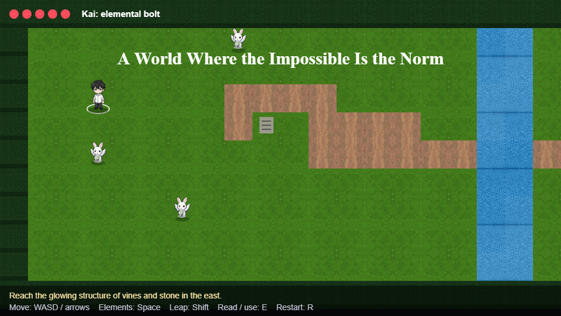
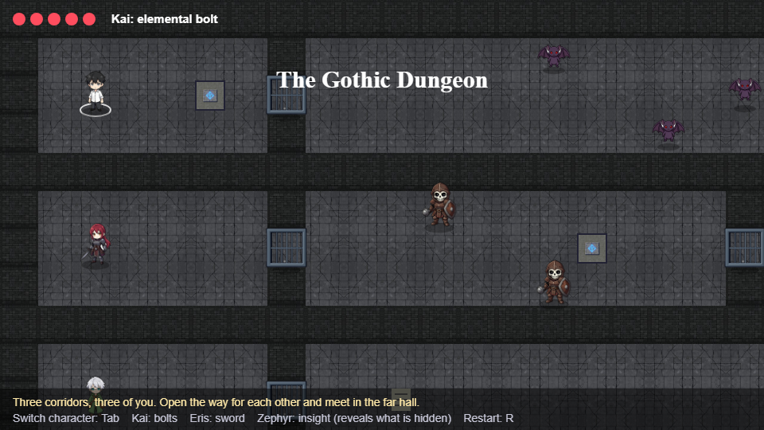
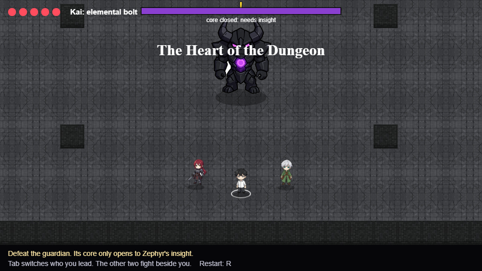

# Instant Dungeon (prototype)

A small browser game made from the short story "Instant Dungeon" (Medium, 2024-01-29). It is a proof of concept:
the story panels, characters, monsters and tiles were generated by an image model, and the game around them was
written to see how far a story can be turned into something playable.

## Play

Open `web/index.html` in a browser. No install and no build step: plain JavaScript on a canvas.

| Key | Action |
|---|---|
| WASD / arrows | move |
| Space | ability (Kai: elemental bolt, Eris: sword, Zephyr: insight) |
| Shift | leap (crosses water) |
| E | read, pull levers, touch orbs, open chests |
| Tab | switch character |
| Enter | advance story panels (Esc skips a chapter) |
| R | restart the level |

Progress is saved in the browser.

## What is in it

- 33 illustrated story panels with captions condensed from the story.
- Four levels: the field, the maze of vines (shifting walls, a rune riddle), the gothic dungeon (three characters
  split by walls who open gates for each other) and the guardian fight.
- Procedural animation: walk cycles, squash and stretch, leaps, hit flashes, dust and camera easing are computed in
  code from one still image per character.

## Known rough edges

- It is a prototype. Gameplay is thin and not balanced.
- The art is AI-generated (FLUX.2 klein 4B, 4 steps) and shows it: some hands and fingers are wrong, and one panel
  puts a scene indoors that the story sets in a field.
- Character designs were invented for the game; the story does not describe them.

## Layout

- `web/` the game (`index.html`, `data.js` for story and levels, `game.js`, `art/`).
- `art/build_manifest.py` the prompts for every image; `art/manifest.json` is its output.
- `tools/smoke.js` a headless test of the maps, mechanisms and the whole story: `node tools/smoke.js`.
